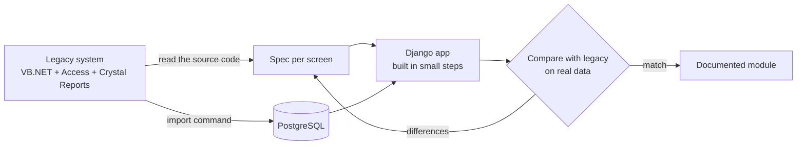

# ERP modernization: a case study

How I am rebuilding a distribution company's legacy desktop ERP as a web application, using Claude Code as my main development tool, and how I check that the new system behaves like the old one.

> **About this repository.** The project itself is for a real business and its source code is private. This repo documents the approach, the architecture and the lessons, with no client name, no real data and no business rules. I am glad to walk through the code in a live session.

**Status:** in progress. Customers, items, suppliers, accounts payable, accounts receivable, invoices (read-only), inventory, sales reports, commissions and user roles work. Registering new invoices is next.

## The problem

A distribution company runs its daily business (inventory, invoicing, receivables, payables, sales reporting, sales commissions) on a desktop application built with **VB.NET WinForms, Microsoft Access and Crystal Reports**. It works, but it only runs on one office PC, it has no documentation, nobody who wrote it is around, and it cannot be reached from outside the office.

Goal: a web version that behaves exactly like the old system on day one, so the staff can switch without retraining, and that is easier to maintain afterwards.

## The approach

1. **Migrate the data first.** A management command imports the Access tables into the new database, with a profile of every column (types, nulls, ranges) and a mapping file. Row counts and totals are checked after every import.
2. **Build the application module by module.** Django 5.2, one app per area (customers and items, suppliers, receivables, inventory, sales, settings). SQLite for development, PostgreSQL for production.
3. **Read the old code, do not trust the screen labels.** For every menu option I read the legacy form's source to see which table it queries, which filters it applies and how it calculates, and write that down as the spec.
4. **Compare on real data.** A command reruns the comparisons between the old report and the new one, so a refactor can be checked in seconds.
5. **Document deliberate differences.** When I intentionally behave differently from the old system, the reason is written down.

## What the comparison found

Examples of what reading the old code and comparing numbers uncovered (details anonymised):

- A screen labelled "ledger by item" actually queried a **per-group** table. The new system now offers both views.
- Two **cost fields with confusing names**: the item sheet displayed a field the old screen never used. Fixed after tracing which column the old screen read.
- A "units sold" report did not use the sales history but the **stock ledger** joined with receivables, so its totals differed from the history by about 5%. I reproduced the original rule and documented why the numbers differ.
- A price-list loop **skipped only one inactive product line** because of a bug in the old code. The new version skips all inactive lines, and this is listed as an intentional difference.
- A report "as of a date" compared the date of the first movement of each group instead of the balance on that date. Fixed in the new version.
- **Data quality surprises**: duplicate invoice numbers and items with stock but no cost. These are reported to the business instead of being silently fixed.

## Architecture

| Area | What it does |
|---|---|
| `core` | Login, menu, roles and permissions, backups, comparison commands |
| `maestros` | Customers, items, product groups |
| `proveedores` | Suppliers and accounts payable, with the tax withholding calculations |
| `cartera` | Accounts receivable with an ageing summary, cash receipts and notes |
| `ventas` | Invoices (read-only for now), sales reports, commissions |
| `inventario` | Stock ledger between dates, valuation, quantity and price adjustments with change history |
| `legado` | Import from Access, column profiles and the mapping to the new models |

Other pieces: role-based access (Administrator, Receivables, Warehouse, Purchasing and Read-only roles, which can be combined), a **read-only mode** so the old and new systems can run side by side, a PostgreSQL backup command, Windows scripts for the office server, a Docker Compose file, and a production guide with a pre-launch checklist.

## Numbers

- ~10,000 lines of Python (excluding migrations), about 150 automated tests
- 18 commits, each one a reviewed, working module
- Tested on SQLite and PostgreSQL 17

## How I work with Claude Code

See [`docs/working-with-claude-code.md`](docs/working-with-claude-code.md): specs first, small reviewable steps, delegating the repetitive work, and verifying everything against the real system.

## Stack

Python 3.11 · Django 5.2 · PostgreSQL · SQLite (dev) · Docker Compose · Claude Code · Git and GitHub

## Contact

Nexon David Veloza Forero · [Portfolio](https://nedavefo.github.io/Portfolio/) · [GitHub](https://github.com/Nedavefo) · [LinkedIn](https://www.linkedin.com/in/nexonveloza/) · nedavefo@gmail.com
